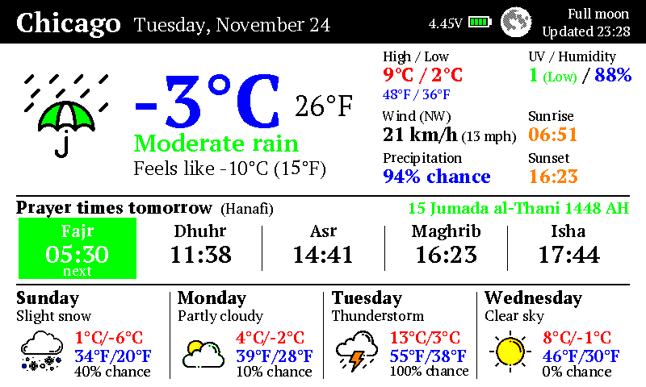
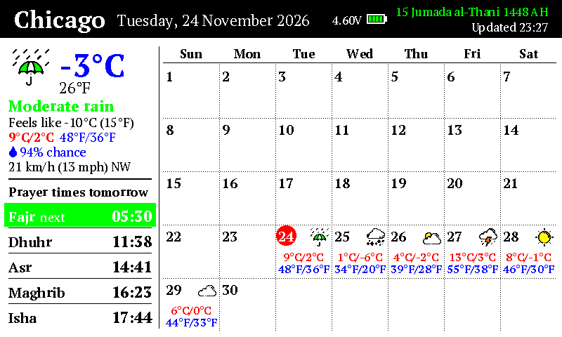
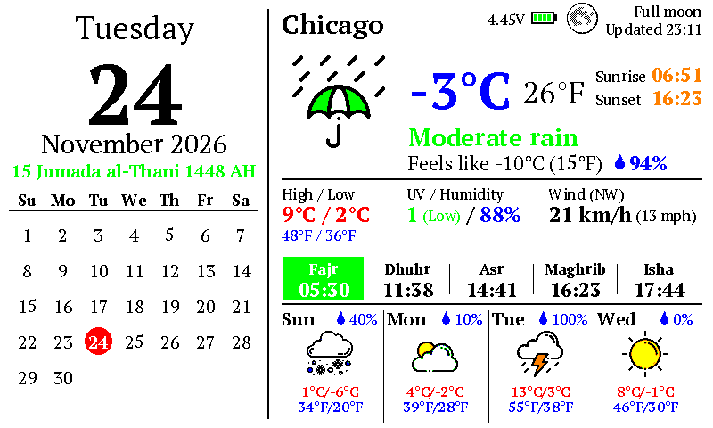
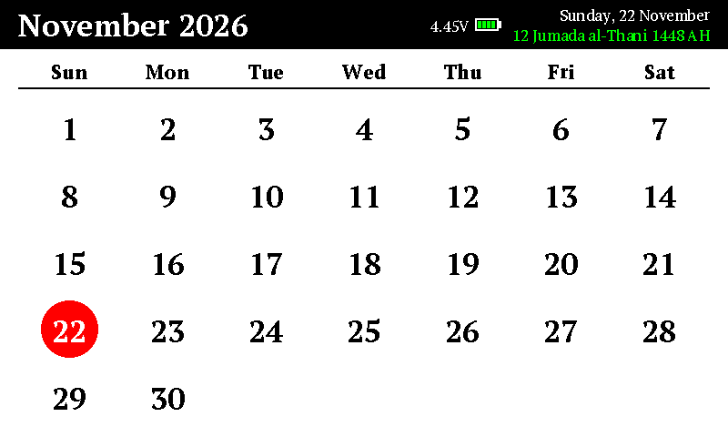

# Inky Frame Weather, Calendar & Prayer Times

A weather station, calendar and Muslim prayer-time display for the **Pimoroni Inky Frame 7.3"** (Raspberry Pi Pico W, MicroPython), running inside Pimoroni's app launcher.

| Calendar + Weather (B) | Date + Weather (C) |
|---|---|
|  |  |

| Calendar (A) | Headlines (D) |
|---|---|
|  |  |

## Features

- **Weather** from Open-Meteo (no API key): now, feels-like, high/low, UV, humidity, wind, sunrise/sunset, precipitation chance and a 4-day forecast, in °C and °F
- **Prayer times** worked out on the frame: 15 calculation methods, Hanafi or standard Asr, per-prayer adjustments, and the next prayer highlighted. Set `SHOW_PRAYER_TIMES = False` in `weather.py` to hide them on the Weather screen (the Calendar + Weather screen always shows them)
- **Hijri date** (Umm al-Qura calendar), changing at Maghrib
- **Calendar** screens: a plain month, one with the weather for the coming days on each date, and a big-date page with the weather beside it
- **Headlines** front page: World, US, Chicago, Bangladesh and Tech news from RSS feeds, with QR codes to open each story on your phone
- **Moon phase**, US **weather alerts**, and a **battery indicator** that tells alkaline from rechargeable AAs
- PT Serif font and the original icons, pre-rendered for the 7-colour e-ink panel

## Buttons

| A | B | C | D | E |
|---|---|---|---|---|
| Calendar | Calendar + Weather | Date + Weather | Headlines | Weather |

## Quick start

1. Copy `sd_card/icons` and `sd_card/fonts` to a FAT-formatted microSD card and put it in the frame.
2. With Thonny, upload everything in `pico/` to the Pico. Save your Wi-Fi details in `secrets.py` (see `secrets.example.py`).
3. Set your location in `weather.py`, then press **Reset** and choose an app.

**Full instructions: [User Manual](docs/USER_MANUAL.md)**

## Repository layout

| Folder | Contents |
|---|---|
| `pico/` | Files for the Pico (launcher, apps, settings, pre-compiled code) |
| `sd_card/` | Icons and fonts for the microSD card |
| `src/` | Source of the pre-compiled `.mpy` files |
| `tools/` | Icon and font converters |
| `docs/` | User manual and screenshots |
| `licenses/` | Licences for the code, font, icons and Hijri table |
