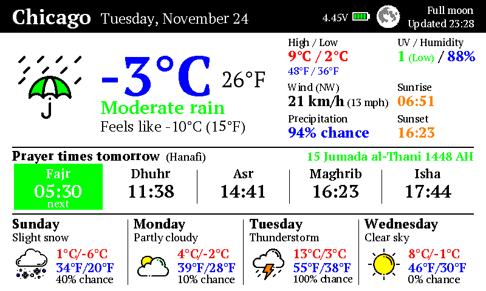
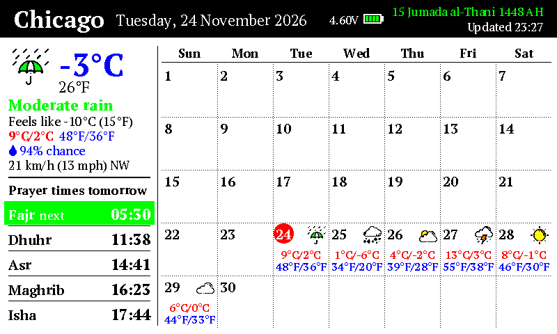
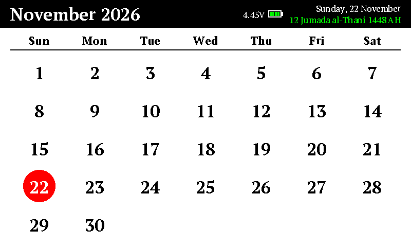
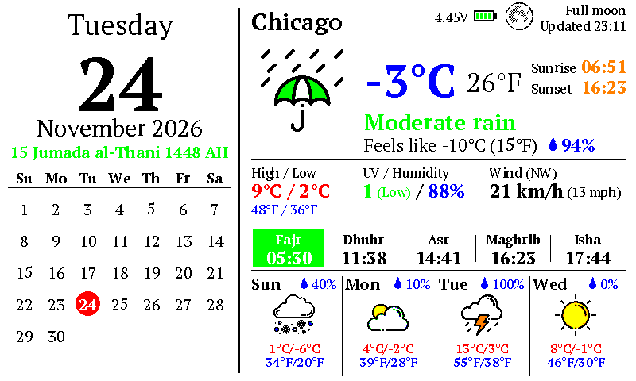
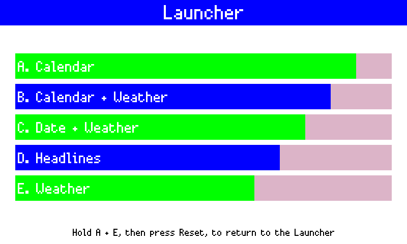
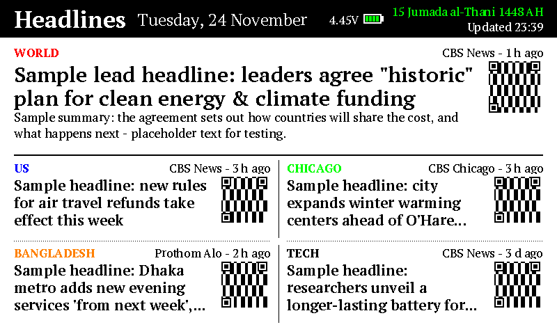
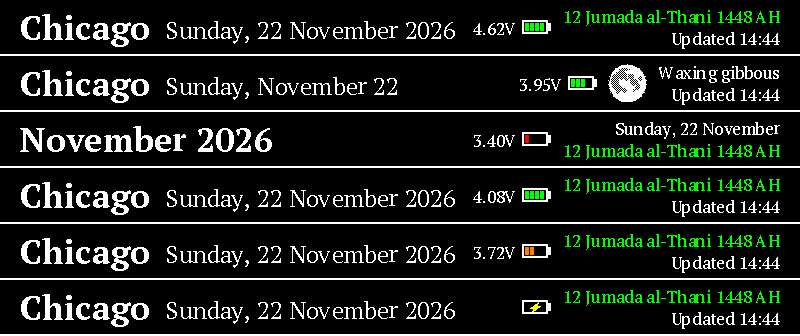

# Inky Frame Weather, Calendar & Prayer Times — User Manual

A weather station, calendar and prayer-time display for the **Pimoroni Inky Frame 7.3"** (Raspberry Pi Pico W).
It started as a Raspberry Pi Zero weather station and was rebuilt to run on the Pico, inside Pimoroni's app launcher.



---

## Contents

1. [What it shows](#1-what-it-shows)
2. [What you need](#2-what-you-need)
3. [Installing](#3-installing)
4. [Settings](#4-settings)
5. [Using the frame](#5-using-the-frame)
6. [The screens in detail](#6-the-screens-in-detail)
7. [Prayer times and the Hijri date](#7-prayer-times-and-the-hijri-date)
8. [Battery indicator](#8-battery-indicator)
9. [Troubleshooting](#9-troubleshooting)
10. [Changing the code, icons or fonts](#10-changing-the-code-icons-or-fonts)
11. [Credits and licences](#11-credits-and-licences)

---

## 1. What it shows

The frame has five buttons, **A to E**. Each one starts an app, and the frame remembers the last one you chose.

| Button | App | What it shows |
|---|---|---|
| **A** | Calendar | This month, today circled in red, today's date and Hijri date |
| **B** | Calendar + Weather | The weather now and today's prayer times on the left; the month on the right, with the weather (icon, high/low in °C and °F) on today and the next 5 days |
| **C** | Date + Weather | A big date with the month and Hijri date and a small calendar on the left; the weather now, details, today's prayer times and a 4-day forecast on the right |
| **D** | Headlines | A newspaper-style front page: a lead story with its summary, and four more headlines, each with a QR code |
| **E** | Weather | The full weather screen: now, details, prayer times and a 4-day forecast |

| Calendar + Weather (B) | Calendar (A) |
|---|---|
|  |  |

| Date + Weather (C) |
|---|
|  |

Weather comes from [Open-Meteo](https://open-meteo.com) (free, no account or API key). Severe weather alerts come from the US National Weather Service. Prayer times, the Hijri date and the moon phase are worked out on the frame itself, with no internet needed.

---

## 2. What you need

- **Pimoroni Inky Frame 7.3"** (the original 7-colour, 800 × 480 model) with its Pico W
- **Pimoroni's Inky Frame MicroPython firmware** (tested with MicroPython 1.29.0), with the launcher
- **A microSD card** formatted FAT (FAT16 or FAT32). It holds the icons and fonts, which are too big for the Pico's own storage.
- **Wi-Fi** (2.4 GHz)
- **Power:** USB, or 3 × AA batteries (alkaline or rechargeable)
- **A computer with [Thonny](https://thonny.org)** to copy files to the Pico

---

## 3. Installing

### 3.1 Get the files

Download this repository (green **Code** button → **Download ZIP**) and unzip it. The folders are:

| Folder | Goes where |
|---|---|
| `pico/` | Onto the Pico, using Thonny |
| `sd_card/` | Onto the microSD card, using your computer |
| `src/`, `tools/`, `licenses/`, `docs/` | Stay on your computer (source code, tools, licences, this manual) |

### 3.2 Copy the icons and fonts to the SD card

1. Put the microSD card in your computer.
2. Copy the **`icons`** and **`fonts`** folders from `sd_card/` to the top level of the card, so the card has `/icons` and `/fonts`.
3. Eject the card properly and put it in the frame's card slot.

> **Mac users:** macOS adds hidden files such as `._clear_64.jpg` and `.Spotlight-V100` to the card. They're harmless and the frame ignores them.

### 3.3 Copy the program to the Pico

1. Connect the frame to your computer with USB and open **Thonny**.
2. At the bottom right of Thonny, choose **MicroPython (Raspberry Pi Pico)**.
3. Open **View → Files**. The top half shows your computer, the bottom half shows the Pico.
4. In the top half, go to the `pico/` folder. Select these files, right-click, and choose **Upload to /**:
   - `main.py` — the launcher
   - `weather.py` — **your settings**
   - `weather_app.mpy`, `prayers.mpy` — the weather and prayer code (pre-compiled)
   - `month_calendar.py`, `calendar_weather.py`, `date_weather.py`, `headlines.py` — the other apps
   - `battery.py` — the battery indicator
5. **Wi-Fi:** if the Pico doesn't already have a `secrets.py`, upload `secrets.example.py`, rename it on the Pico to **`secrets.py`** (right-click → Rename), open it, and type your Wi-Fi name and password. Save with **Cmd+S** / **Ctrl+S**.

> Upload files one by one or a few at a time. If Thonny reports an error while uploading a folder, upload the files individually instead.

### 3.4 Set your location

Open **`weather.py`** on the Pico in Thonny and change at least:

```python
LATITUDE = 41.88
LONGITUDE = -87.63
TIMEZONE = "America/Chicago"
LOCATION_NAME = "Chicago"
```

To find your latitude and longitude, right-click your home in Google Maps and click the numbers to copy them. West longitudes and south latitudes are negative. The time zone is an [IANA name](https://en.wikipedia.org/wiki/List_of_tz_database_time_zones), such as `"Europe/London"` or `"Asia/Dhaka"`.

Save, then press **Reset** on the back of the frame (or unplug and plug it back in).

### 3.5 First start

With no app chosen yet, the frame shows the **Launcher menu**. Press **E** for the weather. A full screen refresh takes about 40 seconds; the colours flash while the panel updates, which is normal.



---

## 4. Settings

All settings are in **`weather.py`**, and all three of the weather, calendar and dashboard apps use them. After changing a setting, save the file and press **Reset**, or press the app's button.

If your `weather.py` doesn't have a setting listed here, the default is used. You can add the line yourself.

### Location and time

| Setting | Default | What it does |
|---|---|---|
| `LATITUDE`, `LONGITUDE` | `41.88`, `-87.63` | Your location (decimal degrees) |
| `TIMEZONE` | `"America/Chicago"` | IANA time zone name |
| `TIMEZONE_LABEL` | `None` | Time zone abbreviation for the classic layout; `None` uses Open-Meteo's |
| `LOCATION_NAME` | `"Chicago"` | Place name in the top band; `""` leaves it out |
| `CLOCK_24H` | `True` | `True` for 16:24, `False` for 4:24 PM |

### Display

| Setting | Default | What it does |
|---|---|---|
| `LAYOUT` | `"modern"` | `"modern"` (made for the 7.3" screen) or `"classic"` (the original Pi layout) |
| `UNITS` | `"C"` | Main units: `"C"` (°C, km/h) or `"F"` (°F, mph) |
| `SHOW_BOTH_UNITS` | `True` | Show the other unit too: °F beside °C, mph beside km/h |
| `FORECAST_DAYS` | `4` | Days in the forecast row of the weather screen: `4` or `3` |
| `FONT` | `"original"` | `"original"` = PT Serif from the SD card. Built-in alternatives: `"serif"`, `"sans"`, `"serif_italic"`, `"gothic"`, `"cursive"`, `"bitmap"` |
| `SHOW_MOON` | `True` | Moon phase in the top band of the weather screen |
| `MOON_SPOTS` | `True` | Grey "seas" on the moon |
| `SHOW_ALERTS` | `True` | US National Weather Service alerts (US locations only) |

### Prayer times and Hijri date

| Setting | Default | What it does |
|---|---|---|
| `SHOW_PRAYER_TIMES` | `True` | Prayer times on the weather screen (in place of the 12-hour chart) |
| `PRAYER_METHOD` | `"ISNA"` | Calculation method. See [section 7](#7-prayer-times-and-the-hijri-date) |
| `ASR_METHOD` | `"hanafi"` | `"hanafi"` or `"standard"` (Shafi'i, Maliki, Hanbali) |
| `PRAYER_ADJUST` | all `0` | Minutes to add or take away per prayer, to match your mosque |
| `HIJRI_ADJUST` | `0` | Move the Hijri date a day later (`1`) or earlier (`-1`) |
| `HIJRI_FROM_MAGHRIB` | `True` | The Hijri date changes at Maghrib (`True`) or at midnight (`False`) |

### Battery

| Setting | Default | What it does |
|---|---|---|
| `SHOW_BATTERY` | `True` | Battery icon in the top band |
| `BATTERY_TYPE` | `"auto"` | `"auto"`, `"alkaline"` or `"rechargeable"`. See [section 8](#8-battery-indicator) |
| `SHOW_BATTERY_VOLTS` | `True` | Battery voltage beside the icon |

### Updates

| Setting | Default | What it does |
|---|---|---|
| `UPDATE_MINUTES` | `60` | Minutes between weather updates (255 at most) |
| `RETRY_MINUTES` | `10` | Minutes before trying again after a failed download (255 at most) |

### Calendar-only settings

`month_calendar.py` (A), `calendar_weather.py` (B) and `date_weather.py` (C) each have one setting at the top of the file:

```python
WEEK_START = "Sunday"     # or "Monday" or "Saturday"
```

---

## 5. Using the frame

### Buttons

- **Press A–E** to switch apps. The button's light comes on and the frame restarts into that app.
- **Press the button of the app that's showing** to refresh it now.
- **Launcher menu:** hold **A and E**, press **Reset**, let go, then pick an app.

### USB power or batteries

- **On USB,** the frame stays on and watches the buttons all the time.
- **On batteries,** it switches itself off between updates to save power. Its clock wakes it for the next update. Pressing a button wakes it too and starts that button's app (or refreshes it, if it's already showing). The screen keeps showing the last picture while it's off, because e-ink needs no power to hold an image.
- **On USB,** a press while the screen is refreshing (about 40 seconds) can be missed. Press again once it's finished.

### When each screen updates

Only the app that's showing updates. The others wait until you press their button.

| Button | App | Updates |
|---|---|---|
| A | Calendar | Every 4 hours, just after midnight, and at Maghrib (for the Hijri date) |
| B | Calendar + Weather | Every `UPDATE_MINUTES` (60), plus 1 minute after each prayer begins |
| C | Date + Weather | Every `UPDATE_MINUTES` (60) |
| D | Headlines | Every 60 minutes (`UPDATE_MINUTES` at the top of `headlines.py`) |
| E | Weather | Every `UPDATE_MINUTES` (60), plus 1 minute after each prayer begins |

If a weather download fails, B and E keep the last screen and try again after `RETRY_MINUTES`. They show an error only after 3 failures in a row.

---

## 6. The screens in detail

### 6.1 Weather (button E)

**Top band:** place, date, battery, moon phase (with its name) and the time of the last update.

**Now (left):** weather icon, the temperature in °C (coloured by temperature) and °F, the conditions, and the feels-like temperature in both units.

**Details grid (right):**

| Box | Shows |
|---|---|
| High / Low | Today's high and low: °C in red on the first line, °F in blue below |
| UV / Humidity | UV index with its level in brackets, coloured by level (green Low, orange Moderate/High, red Very high/Extreme). Then humidity, coloured: orange under 30% (dry), green 30–60%, blue over 60% (humid) |
| Wind (direction) | Speed in km/h, with mph in brackets |
| Sunrise / Sunset | Worked out with the prayer times, so they always match the prayer row |
| Precipitation | The highest chance of rain or snow over the next 12 hours |

**Prayer times:** the five daily prayers, the next one in a green box. The heading shows the Asr method, e.g. **(Hanafi)**, and the **Hijri date** on the right. After Isha it shows tomorrow's times. A red banner replaces the heading while a weather alert is active.

**Forecast (bottom):** 4 days (or 3, see `FORECAST_DAYS`): day name, conditions, icon, high/low in °C (red) and °F (blue), and the chance of precipitation.

### 6.2 Calendar + Weather (button B)

**Left column:** the weather now (icon, temperature in both units, conditions, feels-like, high/low, chance of precipitation, wind), then today's prayer times with the next one in green.

**Right, the calendar:** this month, with today circled in red. Today and the next 5 days show a small weather icon and the high/low, with °C on top (red) and °F below (blue). On very cold or hot days a reading may be too wide for its box; the unit is then written once, as in `-12/-27°C`.

### 6.3 Date + Weather (button C)

**Left, on white:** the day name, a big date, the month and year, the Hijri date (green), and a small calendar of the month with today circled in red.

**Right:** the place, battery, moon phase (with its name) and update time; the weather now (big icon, temperature in both units, sunrise and sunset, conditions, feels-like, and the chance of precipitation over the next 12 hours); details (high/low in °C and °F, UV/humidity, wind); today's five prayer times with the next one in green; and a 4-day forecast with each day's rain chance, icon, and high/low in °C (red) and °F (blue). A weather warning appears as a red bar above the forecast.

### 6.4 Headlines (button D)



A newspaper-style front page. The **lead story** (World) shows its headline, a short summary and a QR code. Below it are four more headlines (US, Chicago, Bangladesh and Tech), each with a coloured section label, its source and how long ago it was published.

**QR codes:** scan one with your phone's camera to open the full story.

**News sources:** set in `FEEDS` at the top of `headlines.py`, as *(section, source, feed address)*. The first entry is the lead story. Any RSS feed works:

```python
FEEDS = (
    ("World", "CBS News", "https://www.cbsnews.com/latest/rss/world"),
    ("US", "CBS News", "https://www.cbsnews.com/latest/rss/us"),
    ("Chicago", "CBS Chicago", "https://www.cbsnews.com/chicago/latest/rss/main"),
    ("Bangladesh", "Prothom Alo", "https://en.prothomalo.com/feed/"),
    ("Tech", "CBS News", "https://www.cbsnews.com/latest/rss/technology"),
)
```

If a feed can't be loaded, its box says so and the rest still show. If the lead feed fails, the next section takes its place. Headlines are shown in English only: the frame's fonts can't draw Bengali script. Set `SHOW_QR = False` to leave out the QR codes.

### 6.5 Calendar (button A)

This month with today circled in red. The top band shows today's date and the Hijri date. It needs Wi-Fi only to learn today's date for your time zone.

### 6.6 Moon phase

The moon is drawn as seen from the northern hemisphere. The lit part is white with grey seas, and the shadow is a dark dotted pattern. Its name ("Waxing gibbous", "Full moon"…) is shown beside it. The four main phases are named only within a day of the exact moment.

---

## 7. Prayer times and the Hijri date

### Calculation methods

Set `PRAYER_METHOD` in `weather.py`:

| Method | Used by / region |
|---|---|
| `"ISNA"` | Islamic Society of North America |
| `"MoonsightingCommittee"` | Moonsighting Committee Worldwide (seasonal Fajr/Isha) |
| `"MWL"` | Muslim World League |
| `"Egypt"` | Egyptian General Authority of Survey |
| `"Makkah"` | Umm al-Qura University, Makkah |
| `"Karachi"` | University of Islamic Sciences, Karachi. Also used in Bangladesh, Pakistan, India and Afghanistan |
| `"Tehran"` | Institute of Geophysics, University of Tehran |
| `"Jafari"` | Shia Ithna Ashari (Leva Institute, Qum) |
| `"Gulf"`, `"Kuwait"`, `"Qatar"`, `"Dubai"` | Gulf countries |
| `"Singapore"`, `"France"`, `"Russia"` | National authorities |

**Asr:** `ASR_METHOD = "hanafi"` uses twice the shadow length (later Asr); `"standard"` uses once the shadow length.

The times use the same method as [Aladhan.com](https://aladhan.com), and were checked against it to the minute for several cities and methods.

### Matching your mosque

Many mosques add a few minutes for safety. Use `PRAYER_ADJUST`, for example:

```python
PRAYER_ADJUST = {"Fajr": 0, "Sunrise": 0, "Dhuhr": 5, "Asr": 0, "Maghrib": 3, "Isha": 0}
```

### Hijri date

The date follows the **Umm al-Qura** calendar (as used by Aladhan) from 1440 to 1500 AH (2018–2077). Outside that range it uses the arithmetic Islamic calendar. Month names use the South Asian forms, e.g. *Jumada al-Awwal*, *Jumada al-Thani*.

- If your community's moon sighting starts months a day later, set `HIJRI_ADJUST = 1` (or `-1` for a day earlier).
- By default the date moves on at **Maghrib**, when the Islamic day begins. Set `HIJRI_FROM_MAGHRIB = False` to change it at midnight instead.

---

## 8. Battery indicator



All five screens show a battery icon at the top:

| Icon | Meaning |
|---|---|
| 4 or 3 green bars | Good |
| 2 orange bars | About half |
| 1 red bar | Low — have new batteries ready |
| Red outline, no bars | Nearly empty — change the batteries |
| Yellow lightning bolt | USB power |

**How it measures:** on a Pico W, the battery is read through a pin shared with the Wi-Fi chip. So the launcher reads the battery right at start-up, before Wi-Fi is switched on, and every app shows that reading.

**Alkaline or rechargeable:** with `BATTERY_TYPE = "auto"`, the frame notices new batteries by the jump in voltage. Fresh alkaline AAs read above about 4.35 V (three together), while fully charged rechargeables (NiMH) read up to about 4.2 V. It remembers the type in `battery.json` until the next change. If it ever guesses wrong (for example, with half-used alkalines), set `BATTERY_TYPE = "alkaline"` or `"rechargeable"`.

**It's an estimate.** AA voltage falls slowly and then quickly near the end, so the last bar goes faster than the first. The voltage beside the icon helps you get to know your batteries. Hide it with `SHOW_BATTERY_VOLTS = False`.

Headlines (D) shows it in its top band too.

---

## 9. Troubleshooting

When an app fails, the frame shows a red **"… stopped with an error"** screen with the details, and tries again in 30 minutes. Press **A–E** to start any app straight away.

| What you see | Cause and fix |
|---|---|
| `Could not get today's date: -2`, or another `-2` error | The frame couldn't reach the internet. It now waits up to 30 seconds for Wi-Fi; if it still fails, check `secrets.py` and your router. |
| `Wi-Fi timed out - check secrets.py` | Wrong Wi-Fi name or password, or a 5 GHz-only network. The Pico W needs 2.4 GHz. |
| `MemoryError` | The Pico ran out of memory. Make sure you uploaded `weather_app.mpy` (not the large `.py`). If it keeps happening, set `FONT = "serif"`. |
| Text looks plain or blocky | The `fonts` folder isn't on the SD card, so the built-in font is used. Copy `sd_card/fonts` to the card. |
| No weather pictures | The `icons` folder isn't on the SD card. Copy `sd_card/icons` to the card. |
| Small calendar icons look soft | The `*_32.jpg` icons are missing from the card. The frame then shrinks the normal icons instead. Copy the `*_32.jpg` files to `/icons` on the card. |
| Forecast temperatures in the calendar drop their units | The newer font files aren't on the card. Copy `original_b.bin` and `original_r.bin` from `sd_card/fonts` again. |
| Buttons do nothing | On batteries, the frame is off between updates; a press wakes it, which takes a few seconds. On USB, make sure `main.py` is the one from this project. |
| Prayer times differ from your mosque | Check `PRAYER_METHOD` and `ASR_METHOD`, then fine-tune with `PRAYER_ADJUST`. |
| Hijri date one day off | Set `HIJRI_ADJUST = 1` or `-1`, or check `HIJRI_FROM_MAGHRIB`. |
| Battery shows the wrong type | Set `BATTERY_TYPE` to `"alkaline"` or `"rechargeable"`. |

**Free space on the Pico:** type this in Thonny's Shell:

```python
import os; s = os.statvfs("/"); print(s[0] * s[3] // 1024, "KB free")
```

**Seeing what the frame is doing:** with the frame connected to Thonny, press **Stop**, then **Reset** on the frame (or run `main.py`). Each step is printed in Thonny's Shell.

---

## 10. Changing the code, icons or fonts

### The weather and prayer code

The Pico can't compile the large weather program itself without running out of memory, so it's shipped pre-compiled (`.mpy`). The source is in `src/`. After changing `src/weather_app.py` or `src/prayers.py`, compile it with **mpy-cross from MicroPython 1.29** (it must match the firmware's version):

```bash
pip install mpy-cross         # pick the version matching your firmware, e.g. mpy-cross==<version>
cd src
mpy-cross weather_app.py      # makes weather_app.mpy
mpy-cross prayers.py          # makes prayers.mpy
```

The firmware prints its version when Thonny connects (e.g. *MicroPython v1.29.0*). A `.mpy` made by a different version gives an "incompatible .mpy file" error on the frame.

Then upload the new `.mpy` files to the Pico. `month_calendar.py`, `calendar_weather.py`, `battery.py` and `main.py` are small enough to run as normal `.py` files.

### Icons

`tools/make_icons.py` turns the original weather pictures into Pico-ready icons, at the exact sizes the screens use (128, 64 and 32 px, plus the 37 px wind icon), snapped to the panel's 7 colours:

```bash
pip install pillow
python tools/make_icons.py path/to/weather_jpg sd_card/icons --screen 7.3
```

### Fonts

`tools/make_font.py` pre-renders a TrueType font into the two files the frame reads (`original_r.bin` and `original_b.bin`):

```bash
python tools/make_font.py PTSerif-Regular.ttf PTSerif-Bold.ttf sd_card/fonts
```

To use a different font, run it with that font's Regular and Bold `.ttf` files and copy the results to `/fonts` on the card.

---

## 11. Credits and licences

- **Original Raspberry Pi weather station** (`open-weather-epaper`): MIT licence, see `licenses/LICENSE`.
- **Weather data:** [Open-Meteo](https://open-meteo.com) (CC BY 4.0). **Alerts:** US National Weather Service.
- **Launcher and app framework:** based on Pimoroni's Inky Frame examples (MIT).
- **Headlines:** from the RSS feeds of CBS News and Prothom Alo English; the stories belong to their publishers.
- **PT Serif font:** ParaType, SIL Open Font Licence, see `licenses/OFL-PT-Serif.txt`.
- **Weather icons:** from Flaticon, see `licenses/icons_license.html`. Flaticon's free licence requires attribution; check its terms before reusing the icons elsewhere.
- **Umm al-Qura Hijri month table:** from the `hijridate` package (MIT), see `licenses/LICENSE-hijridate-ummalqura-table`.
- **Prayer time method:** follows PrayTimes.org's calculation, as used by Aladhan.com.
